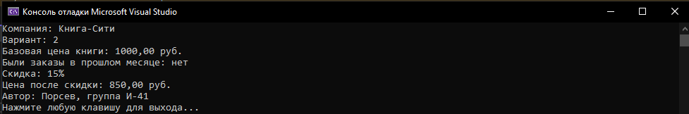
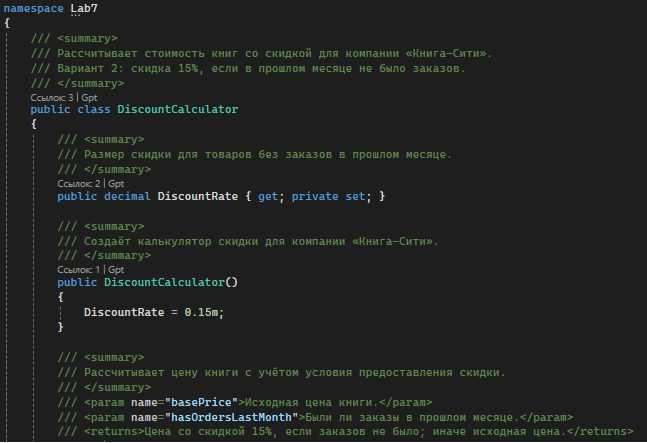
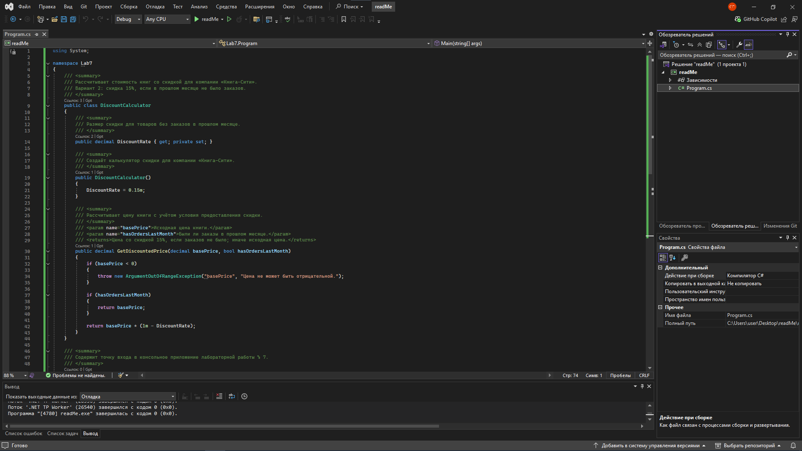

# Система заказов компании «Книга-Сити»

**Автор:** Порсев  
**Группа:** И-41  
**Вариант:** 2

## Что делает программа

- Рассчитывает цену книги со скидкой 15%, если по товару не было заказов в прошлом месяце.
- Если в прошлом месяце были заказы, возвращает базовую цену без скидки.
- Выводит в консоль базовую цену, наличие заказов, размер скидки и итоговую цену.
- Выводит фамилию автора и группу.
- Содержит XML-комментарии к публичным классам, свойству, конструктору и методам.

## Как запустить

1. Откройте файл readMeLab.sln в Visual Studio или SharpDevelop.
2. Запустите приложение клавишей **F5** или кнопкой **Run**.
3. В консоли отобразится результат расчёта.

Для примера используется базовая цена книги **1000 рублей**. Поскольку заказов в прошлом месяце не было, скидка составляет 15%, а итоговая цена — **850 рублей**.

Пример вывода:

```text
Компания: Книга-Сити
Вариант: 2
Базовая цена книги: 1000.00 руб.
Были заказы в прошлом месяце: нет
Скидка: 15%
Цена после скидки: 850.00 руб.
Автор: Порсев, группа И-41
```

## Скриншоты

### 1. Результат работы программы



### 2. XML-комментарии в коде



### 3. Среда разработки



## Структура проекта
```text
readMeLab/
├── docs/
│   ├── screenshot1.png
│   ├── screenshot2.png
│   └── screenshot3.png
├── Program.cs
├── readMe.csproj
└── README.md
```
